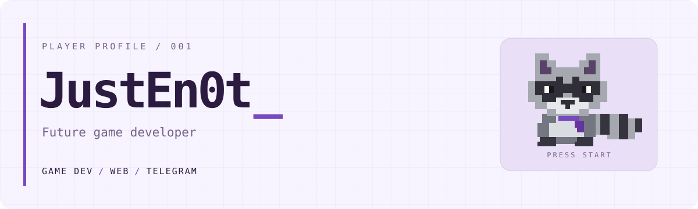
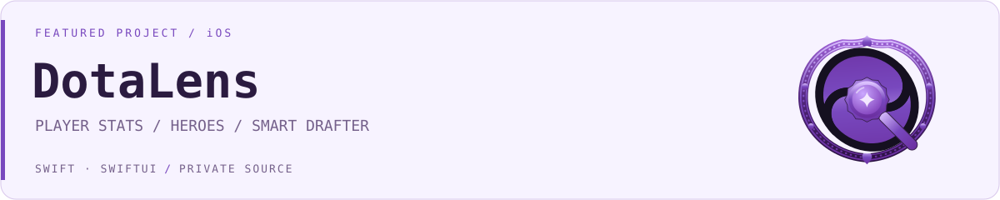
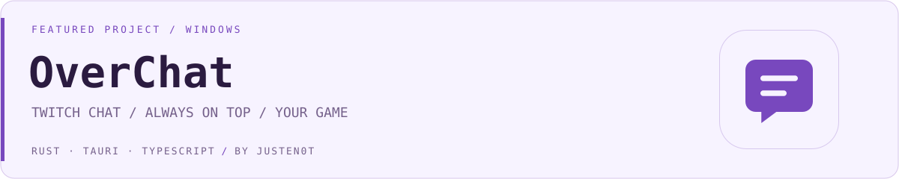
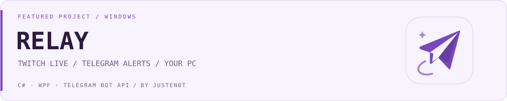
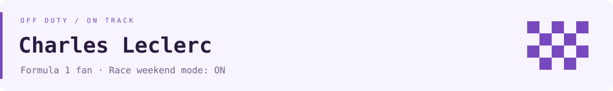

<picture>
  <source media="(prefers-color-scheme: dark)" srcset="assets/header-violet-dark.svg">
  
</picture>

### Арсений / JustEn0t

Делаю приложения, сайты и Telegram-ботов. Следующая цель — собственные игры.

```text
PLAYER       JustEn0t
MAIN QUEST   Стать game developer
SIDE QUESTS  Сайты · Telegram-боты
STATUS       В работе
```

### Проекты

<picture>
  <source media="(prefers-color-scheme: dark)" srcset="assets/dotalens-violet-dark.svg">
  
</picture>

**DotaLens** — моё приложение для Dota 2 на iOS. Статистика игроков, энциклопедия героев и предметов, анализ драфта и рекомендации контрпиков.

`Swift 6` · `SwiftUI` · `OpenDota API` · `Закрытый исходный код`

[Подробнее о DotaLens](https://github.com/JustEn0t/DotaLens-showcase)

<picture>
  <source media="(prefers-color-scheme: dark)" srcset="assets/overchat-violet-dark.svg">
  
</picture>

**OverChat** — моё приложение для стримеров: чат Twitch поверх игры или любого другого окна Windows. Прозрачный оверлей, сквозные клики, горячие клавиши и смайлики Twitch и 7TV.

`Rust` · `Tauri 2` · `TypeScript` · `Windows` · `Публичный исходный код`

[Подробнее об OverChat](https://github.com/JustEn0t/OverChat)

<picture>
  <source media="(prefers-color-scheme: dark)" srcset="assets/relay-violet-dark.svg">
  
</picture>

**RELAY** — моё приложение для стримеров: анонсы Twitch в Telegram с собственного ПК. Карточка с игрой и названием, обновление статуса во время эфира и автоматическое удаление поста после стрима.

`C#` · `WPF` · `Telegram Bot API` · `Windows` · `Публичный исходный код`

[Подробнее о RELAY](https://github.com/JustEn0t/Relay) · [Скачать EXE](https://github.com/JustEn0t/Relay/releases/latest)

### Чем занимаюсь

**Game development** — главное направление, в котором хочу развиваться.

**Web** — сайты, интерфейсы и интерактивные идеи.

**Telegram** — боты, которые помогают с повседневными задачами.

### F1 / Charles Leclerc

<picture>
  <source media="(prefers-color-scheme: dark)" srcset="assets/f1-purple-flag-dark.svg">
  
</picture>
