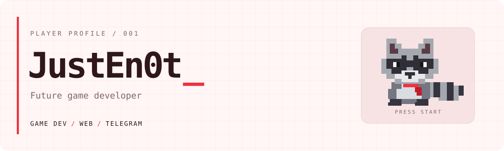
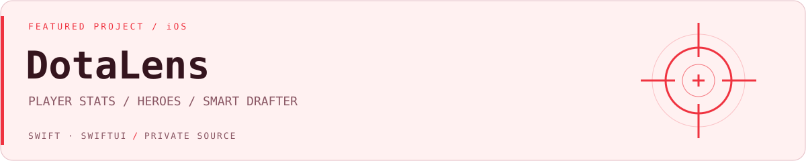
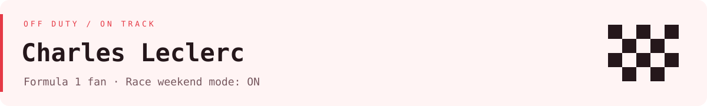

<picture>
  <source media="(prefers-color-scheme: dark)" srcset="assets/header-red-dark.svg">
  
</picture>

### Арсений / JustEn0t

Делаю приложения, сайты и Telegram-ботов. Следующая цель — собственные игры.

```text
PLAYER       JustEn0t
MAIN QUEST   Стать game developer
SIDE QUESTS  Сайты · Telegram-боты
STATUS       В работе
```

### Проекты

<picture>
  <source media="(prefers-color-scheme: dark)" srcset="assets/dotalens-dark.svg">
  
</picture>

**DotaLens** — моё приложение для Dota 2 на iOS. Статистика игроков, энциклопедия героев и предметов, анализ драфта и рекомендации контрпиков.

`Swift 6` · `SwiftUI` · `OpenDota API` · `Закрытый исходный код`

[Подробнее о DotaLens](https://github.com/JustEn0t/DotaLens-showcase)

### Чем занимаюсь

🎮 **Game development** — главное направление, в котором хочу развиваться.

🌐 **Web** — сайты, интерфейсы и интерактивные идеи.

🤖 **Telegram** — боты, которые помогают с повседневными задачами.

### F1 / Charles Leclerc

<picture>
  <source media="(prefers-color-scheme: dark)" srcset="assets/f1-dark.svg">
  
</picture>
